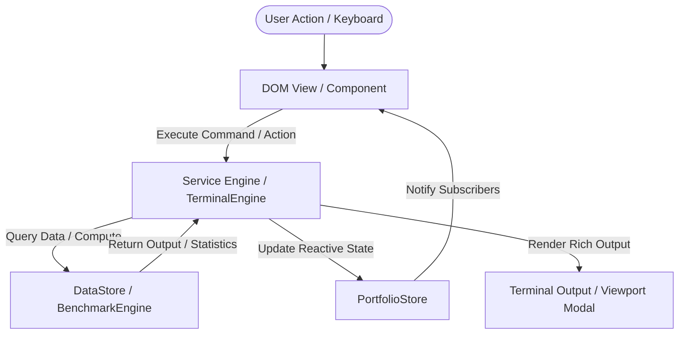

# Architecture & Engineering Guide

## 1. System Overview

This repository powers **Justin Joe Mathew's engineering portfolio** ([jvstin47.github.io/47](https://jvstin47.github.io/47/)), showcasing autonomous systems, edge AI micro-UAVs (SIH 26177), markerless 6-DoF spatial camera tracking (SIH 26169), and stochastic Monte Carlo race simulation engines.

The site is built with a **modular vanilla JavaScript & CSS architecture** designed for zero-build static hosting on GitHub Pages, while adhering to modern enterprise design principles:
- **Clean Separation of Concerns**: Pure domain models and compute engines live in `js/services/`, completely decoupled from DOM presentation components in `js/components/`.
- **Environment & Configuration Isolation**: All constants, feature flags, API endpoints, and storage keys are centralized in `js/config.js`.
- **Reactive State Management**: Pub/Sub state store (`js/state.js`) synchronizing application state with persistent local storage.
- **Enterprise Error Handling & Boundaries**: Centralized `ErrorHandler` (`js/utils/error-handler.js`) providing global uncaught error boundaries, localStorage fallbacks, and non-intrusive UI toast feedback.
- **Scalable API Architecture**: Normalized HTTP client (`js/api/api-client.js`) with timeout handling, exponential backoff retries, and an in-memory/session-cached GitHub service (`js/api/github-service.js`).

---

## 2. Directory Structure

```tree
.
├── ARCHITECTURE.md              # System design, data flow, and maintenance guide
├── README.md                    # Project presentation & quick start
├── index.html                   # Flagship systems landing page & interactive terminal
├── projects.html                # Complete verified engineering systems & deep dives
├── ideas-lab.html               # Autonomous experiments, patents, & hackathon concepts
├── portfolio.html               # Condensed executive presentation
├── styles.css                   # Core tokens, typography, glassmorphism, & layout foundation
├── index.css                    # Flagship landing page specific styles & animations
├── projects.css                 # Project directory layout & telemetry card styles
├── ideas-lab.css                # Experiments lab grid styles
├── portfolio.css                # Executive showcase layout styles
├── interactive-trends.js        # Cutting-edge kinetic typography, magnetic cursor, & canvas mesh
├── satellite.html               # Multi-window detached kinetic HUD
├── js/
│   ├── config.js                # AppConfig: environment variables, feature flags, API endpoints
│   ├── state.js                 # PortfolioStore: reactive pub/sub state manager
│   ├── app.js                   # PortfolioApp: orchestrator bootstrapping services and views
│   ├── api/
│   │   ├── api-client.js        # Resilient HTTP client with retry backoff & timeout handling
│   │   └── github-service.js    # GitHub API integration with rate-limit caching
│   ├── services/
│   │   ├── data-store.js        # Single source of truth for projects, skills, virtual filesystem
│   │   ├── benchmark-engine.js  # Pure computation: Monte Carlo simulations & mathematical solvers
│   │   └── terminal-engine.js   # Pure command interpreter, fuzzy path resolver, & autocomplete
│   ├── components/
│   │   ├── theme-controller.js  # Light/dark mode synchronizer & OS preference observer
│   │   ├── navigation-controller.js # Scroll spy, progress bar, mobile drawer, email copy, toolkit
│   │   ├── tech-terminal.js     # View controller bridging DOM to TerminalEngine
│   │   ├── photo-deck-view.js   # 3D perspective portrait deck cycling controller
│   │   ├── prism-view.js        # 3D glass card tilt physics & spotlight tracking
│   │   └── cert-modal.js        # Certificate lightbox modal view controller
│   └── utils/
│       ├── dom.js               # Safe DOM querying, event delegation, and HTML escaping
│       ├── error-handler.js     # Global error boundaries, safe storage, and UI toast notifications
│       └── formatters.js        # Markdown parser, relative time, and numerical formatters
```

---

## 3. Core Architectural Patterns

### 3.1. Separation of Concerns (Business Logic vs. UI)

| Layer | Directory | Responsibilities | Dependencies |
| :--- | :--- | :--- | :--- |
| **Config** | `js/config.js` | Environment variables, endpoints, storage keys, feature flags | None |
| **State** | `js/state.js` | Reactive application state, Pub/Sub event bus, persistence | `config.js` |
| **Services** | `js/services/` | Virtual filesystem, command interpretation, Monte Carlo math | Pure JS (No DOM) |
| **Components** | `js/components/`| Event listeners, DOM manipulation, animations, modal transitions | `services/`, `utils/`, `state.js` |
| **Utilities** | `js/utils/` | String escaping, markdown parsing, error boundaries, DOM queries | None |
| **Orchestrator**| `js/app.js` | Dependency injection, lifecycle bootstrapping, global export | All modules |

### 3.2. Data Flow



### 3.3. Virtual Terminal Subsystem

1. **`DataStore` (`js/services/data-store.js`)**: Holds the complete virtual directory tree and file contents (source files, logs, READMEs, specifications).
2. **`TerminalEngine` (`js/services/terminal-engine.js`)**:
   - Resolves directories with fuzzy alias matching (e.g., `cd phoenix` -> `~/projects/phoenix-uav`).
   - Autocompletes commands (`help`, `ls`, `cat`, `cd`, `bench`, etc.) and paths via Tab.
   - Maintains command history buffers.
   - Evaluates commands purely in memory and returns normalized response objects.
3. **`TechTerminal` (`js/components/tech-terminal.js`)**:
   - Listens to keystrokes on `#term-input`.
   - Delegates parsing to `TerminalEngine`.
   - Translates responses into formatted HTML inside `#term-output` or opens the full-screen `#term-viewport`.

---

## 4. Error Handling & Resilience

The application features a 3-layer error boundary implemented in `js/utils/error-handler.js`:

1. **Global Uncaught Boundaries**: Catches `window.onerror` and `window.onunhandledrejection`. In production, errors are suppressed from disrupting user experience while being logged to diagnostic telemetry.
2. **Safe Storage Wrappers**: `ErrorHandler.safeStorage` provides seamless fallbacks to in-memory dictionaries when third-party browser privacy settings block `localStorage` access.
3. **Non-Intrusive UI Feedback**: When network requests or clipboard permissions fail, a subtle floating toast message notifies the user without crashing the thread.

---

## 5. Scalable API Client

The `ApiClient` (`js/api/api-client.js`) and `GitHubService` (`js/api/github-service.js`) provide:
- **Automatic Request Timeouts**: Configurable timeout defaults prevent hanging promises.
- **Exponential Backoff Retries**: Transient 5xx network hiccups automatically retry up to 3 times with exponential backoff and jitter.
- **Multi-Tier Rate-Limit Caching**: GitHub API repository metadata is cached in `sessionStorage` with a 15-minute TTL, eliminating GitHub rate-limit exhaustion.

---

## 6. Maintenance & Development Guidelines

1. **Adding a New Project to the Terminal**:
   - Open `js/services/data-store.js`.
   - Add the project slug to `FILE_SYSTEM['~/projects']`.
   - Add the directory entry and files (e.g. `README.md`, source scripts).
   - Add the file contents to `FILE_CONTENTS`.
   - The terminal will immediately support `cd <project>`, `cat <file>`, and Tab-autocomplete with zero HTML edits.

2. **Modifying Themes or Tokens**:
   - Color tokens and typography variables are maintained in `styles.css` under `:root` and `body.light`.
   - Dynamic class toggling is orchestrated by `js/components/theme-controller.js`.

3. **Running Without Build Step**:
   - All modules use standard UMD/browser-compatible patterns.
   - Open any HTML file in a browser, or run a static server:
     ```bash
     python3 -m http.server 8000
     ```
